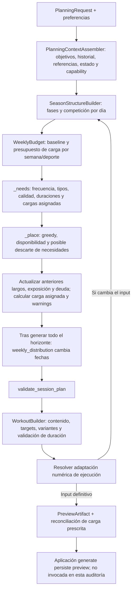
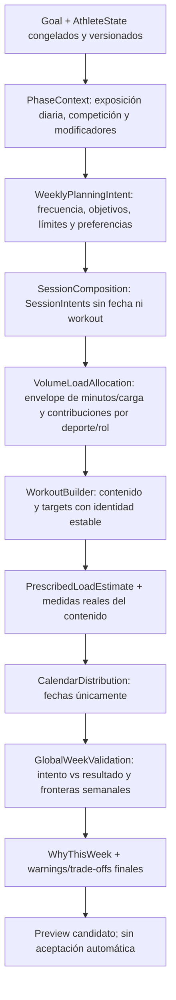

# 0.8G.2E.1 — Coherent Weekly Planning Engine

Version publicable anonimizada del diseno original. Identidad, fechas e identificadores de las capturas se omiten; contratos, reglas y criterios tecnicos se conservan. Las evidencias originales permanecen solo localmente.

Entrega de diseño y auditoría, [fecha omitida]. No se ha implementado el rediseño ni cambiado fórmulas, código de producto, preferencias, planes reales o aceptaciones.

La carencia principal es un contrato de coherencia de semana: existen presupuesto, necesidades de sesión, prescripciones y diagnóstico, pero ninguna unidad conserva de principio a fin lo solicitado, lo ajustado, lo construido y sus diferencias. El calendario no puede resolver esa carencia.

## Alcance y evidencia

Se revisó el código del workspace, incluidos los cambios E.1 ya presentes; no se asumió que HEAD reflejase ese estado. Se regeneró en memoria el horizonte [fecha omitida]–[fecha omitida] con el motor actual y el mismo as-of de E.1. Las lecturas de PostgreSQL se hicieron con `REPEATABLE READ READ ONLY` y rollback; no se llamó a `PlanningPreviewApplication.generate`, que persiste previews, ni a `accept`.

Hay una discrepancia de entrada que debe conservarse en la auditoría:

| Entrada | Target total | Máximo semanal | Origen |
| --- | ---: | ---: | --- |
| Preferencias persistidas, versión 10 | null | 6 | Lectura actual; sin modificar |
| Escenario principal solicitado | 6 | 12 | Copia en memoria de las preferencias |
| Prueba de capacidad actual | 6 | 6 | Copia en memoria, conservando el máximo persistido |

En los tres casos se conservan fuerza 2, máximo diario 2, siete días disponibles, lunes preferido libre, largo de carrera viernes y largo de bici domingo. El escenario principal reproduce exactamente el artefacto anterior de dobles: fingerprint `[huella de captura omitida]`. La diferencia de la primera reproducción se explicó por el cambio de versión de preferencias y del máximo semanal; no se ocultó como ruido de fingerprint.

Entregables de apoyo:

- [49 semanas, agrupación por fase y tabla completa](coherent-weekly-horizon-audit.md).
- [JSON con conteos, minutos por deporte, largos, ejercicios, dobles y warnings](../informe/coherent-weekly-horizon-audit.json) y [CSV](../informe/coherent-weekly-horizon-audit.csv).
- [Trazas de duración y composición del caso con máximo 6](../informe/coherent-weekly-audit-evidence.json).
- [Validación del escenario solicitado con máximo 12](../informe/coherent-weekly-requested-validation.json).
- [Snapshot congelado de contexto y propuestas para reproducción offline](../informe/coherent-weekly-audit-input.json). Es evidencia local de auditoría, no una preferencia nueva ni un plan aceptado.

## A. Pipeline actual

El código ya decide algunos componentes antes del workout: `_frequency`, `_type_sequence`, `_Need` y `WeeklyTrainingBudget`. Por tanto, el cambio correcto es extraer y completar contratos existentes, no sustituir todo por una arquitectura ajena. El orden exacto actual tampoco es «colocar y luego repartir carga»: `_needs` reparte la carga **antes** de `_place`, y la distribución definitiva ocurre **antes** de construir workouts.

Fuentes: [orquestación](../backend/app/application/planning_preview.py#L86), [necesidades](../backend/app/domains/planning/session_planning.py#L507), [bucle de semanas](../backend/app/domains/planning/session_planning.py#L850), [distribución posterior](../backend/app/domains/planning/session_planning.py#L967), [diagnóstico](../backend/app/domains/planning/prescribed_load.py#L201).

## B. Problemas arquitectónicos encontrados

1. **Intento repartido entre objetos.** `WeeklyTrainingBudget` carece de target semanal de minutos y de volumen objetivo por deporte; `DisciplineBudget.available_minutes` se rellena con null. `_Need` mezcla rol, duración, carga, prioridad y opcionalidad sin explicar cada decisión. `frequency_decision` registra un resumen, no la cadena de ajustes.
2. **Composición y carga desacopladas de contenido.** Las sesiones reciben el presupuesto por pesos 1,35 para largo, 1,10 para calidad y 1 para el resto. La duración se calcula por otra vía. El builder no utiliza esa carga asignada para construir el workout. Sumar asignaciones y obtener el presupuesto es una identidad contable, no una comprobación de lo prescrito.
3. **La colocación puede perder sesiones.** `_place` emite warning y continúa si no encuentra candidato. El optimizador recibe únicamente lo colocado; no puede recuperar una necesidad descartada. La búsqueda de dobles del greedy se abandona si existe cualquier candidato de fallback, aunque ocupe descanso preferido; la mejora se deja a la redistribución posterior.
4. **Progresiones distintas sin reconciliación semanal.** Presupuesto, largos, natación y contenido utilizan estados/relojes diferentes. La descarga de carga no implica descarga coherente de todos los deportes o de fuerza. Parte de la exposición se actualiza antes de la distribución final.
5. **Dependencia del contenido respecto a la fecha.** Variantes y nivel dependen de la fecha greedy original. El builder usa `placement.context.original_date` para conservar el contenido tras moverlo. Esa protección funciona, pero revela que la fecha de colocación está haciendo de identificador de progresión.
6. **Precedencia blanda incorrecta.** La tupla actual empieza por adyacencias de fuerza, después descanso y después largos preferidos. Una preferencia del dominio puede ganar a una preferencia explícita del usuario. En el greedy los puntos de día preferido compiten además con minutos sobrantes, que pueden ser mayores.
7. **Warnings producidos en distintos momentos.** Se generan durante el greedy, durante el resumen semanal y después en la distribución. Esta última solo recalcula tres familias y solo cuando el calendario cambia en modo explícito. No hay un único evaluador final de preferencias y trade-offs.
8. **Validación fragmentada.** Hay validadores de sesión, workout y artefacto, más reconciliación. Falta el contraste final contra el intento original y una explicación de imposibilidad. Si la búsqueda no encuentra solución y la entrada ya era inviable, `distribute_week` devuelve la entrada: el validador posterior puede rechazarla, pero el optimizador no distingue infeasibilidad de agotamiento de búsqueda.
9. **Presupuesto de sesiones clave ambiguo.** El default dice `max_key_sessions_per_week=2`, pero dos largos estructurales más una calidad están permitidos por la fórmula efectiva. Las semanas BASE examinadas tienen tres claves en días distintos. No cambiar esa política sin explicitar qué cuenta ese máximo.
10. **Configuración con nombres sin efecto actual.** `long_duration_growth_limit`, `maximum_frequency_increase_per_discipline` y `goal_allocation_weight` están declarados pero no se utilizan en las reglas revisadas. No pueden aparecer como protecciones aplicadas en una explicación.

No se ha demostrado un fallo de seis sesiones en las semanas BASE del escenario principal. Tampoco hay warnings de descanso/largos contradiciendo esas semanas actuales. Sí existen rutas arquitectónicas que permiten discrepancias y que requieren tests; deben distinguirse de un incidente reproducido.

## C. Pipeline propuesto

El envelope debe fijarse antes del builder, y `VolumeLoadAllocation` debe distribuirlo, no inventarlo retrospectivamente a partir del resultado. La composición determina qué roles caben en ese envelope; si el par composición/envelope es inconsistente, se devuelve una revisión al orquestador con motivo explícito. No se permite que el distribuidor lo arregle quitando sesiones o recortando duraciones.

La adaptación numérica existente se normaliza como input versionado antes de la pasada definitiva. Puede mantenerse la pasada provisional actual para resolverla. Debe registrarse qué pasada es provisional y cuál produce la evidencia final; no duplicar deuda/progresión por ejecutar dos veces.

Una revisión futura puede explorar otro candidato de composición o asignación, dentro de un límite y con trazabilidad. Ese bucle pertenece al constructor de semana, no al calendario. Esta primera implementación propuesta debe conservar las reglas numéricas actuales y hacer visibles sus limitaciones antes de calibrarlas.

## D. Contratos internos propuestos

`WeeklyPlanningIntent` sería inmutable. Los nombres siguientes son de diseño; no se ha añadido un modelo al código.

| Bloque | Campos y significado |
| --- | --- |
| Identidad | `week_id`, inicio/fin, timezone, revisión del objetivo, estado del atleta, versiones de reglas e input fingerprint |
| Contexto | fase dominante **y** exposición diaria; eventos, fechas reservadas, horizonte parcial |
| Frecuencia | `requested_training_sessions`, `phase_adjusted_training_sessions`, `horizon_adjusted_training_sessions`; decisiones con origen, antes/después y razón; fuerza/endurance solicitados y ajustados |
| Capacidad | máximo semanal/diario, slots por día, minutos y límites por slot, capacidad teórica y límites por competición; mantenerlos separados del target |
| Composición | conteos deseados por deporte; `why_run_count`, `why_bike_count`, `why_swim_count`, `why_strength_count`; alternativas consideradas |
| Roles | intents de largos, calidad, técnica/aeróbico, fuerza 1/2; importancia, clave/no clave y política de conteo de claves |
| Envelope | `weekly_load_budget`, rango de carga existente, `weekly_minutes_target`, rangos y `sport_volume_targets`; procedencia, incertidumbre y estado de resolución de cada magnitud |
| Calendario | días preferidos libres, días no disponibles, días preferidos de largos, sesiones/fechas fijas, calendario de frontera anterior/siguiente |
| Dobles | habilitación resuelta con motivo; matriz de compatibilidad por objetivos relacionados y pares; capacidad diaria; margen existente, si lo hubiera |
| Progresión | referencia histórica; anterior planificado/aceptado/ejecutado con origen explícito; último largo relevante, ciclo y exposición/deuda; ningún dato futuro simulado se presenta como ejecución real |
| Modificadores | recovery, taper, deload, competición, moderación por estado; ámbito de aplicación y regla existente que los produce |
| Políticas | lista tipada de hard constraints y soft preferences con precedencia; excepciones solo si existen explícitamente |
| Explicación | `DecisionTrace[]`, conflictos, campos no resueltos, razones de mantenimiento o saturación y supuestos |

`SessionIntent` contendría `session_id` estable, ordinal, sport, role, tipo existente candidato, importancia, key, objetivo de volumen/contribución de carga, día preferido, objetivos relacionados, compatibilidad y `progression_trace`. Sin fecha definitiva ni pasos completos del workout. Fuerza 1/2 identifican ocurrencias; no implican contenido A/B nuevo.

Una traza debe conservar `rule_id/version`, inputs con unidades y procedencia, valor anterior, propuesta, floors/caps en **orden real**, valor final, motivo y alternativas. Una lista genérica de factores no basta: actualmente los largos pueden reemplazar la propuesta por una descarga, en lugar de multiplicar el valor ya limitado.

El resultado complementario sería `WeeklyPlanEvaluation`:

- requested / phase-adjusted / horizon-adjusted / feasible capacity / built count;
- minutos y carga: intent / asignación / workout final / estimación e incertidumbre;
- composición y roles deseados frente a construidos;
- factibilidad hard, cumplimiento de preferencias, trade-offs y score desglosado;
- estado de búsqueda: nodos, límite, mejor candidato y existencia de testigo factible;
- estado de coherencia: `COHERENT`, `REVIEW_REQUIRED`, `INTENT_INCOMPLETE` o `INFEASIBLE`.

Esos estados de diseño no sustituyen silenciosamente los estados actuales de reconciliación o aceptación. Se mapearán de forma explícita durante la implementación. Un dato desconocido sigue siendo null con razón, nunca cero o un valor final copiado para fingir un target previo.

Invariantes: fuerza + endurance = total de entrenamientos; competición contabilizada aparte del target habitual y con su consumo de capacidad documentado; una doble contiene dos IDs; el calendario conserva IDs/contenido/duración; toda diferencia de frecuencia tiene causa. El máximo semanal actual cuenta también el marcador de competición: hay que mantener esa semántica hasta decidir explícitamente si cambia.

## E. Componentes que se reutilizan

| Componente | Reutilización |
| --- | --- |
| PlanningContextAssembler y snapshots | Fuente de datos congelados, aislamiento del atleta, objetivos y referencias; no sustituir por lecturas dispersas |
| SeasonStructureBuilder | Exposición diaria y marcadores; conservar inicialmente sus reglas y hacer visible MAINTENANCE |
| WeeklyBudget y LoadBaseline | Mediana de bandas históricas, presupuesto/rangos y ajustes existentes; separar disponibilidad de minutos objetivo |
| `_explicit_frequency` y reparto de shares | Base para composición determinista; extraer decisiones y separar capacidad del intento |
| QualityExposure / selección y deuda | Reglas de calidad existentes; mantener la trazabilidad y controlar su actualización |
| `_duration` y `_swim_duration` | Reglas numéricas iniciales, envueltas por trazas exactas; no cambiar caps o pasos en el refactor |
| WorkoutBuilder, catálogos, targets/adaptación y validadores | Construcción y semántica ya soportada; no nuevos ejercicios, bricks o fórmulas fisiológicas |
| `session_compatibility` | Matriz existente y asociaciones de objetivos; conservar prohibición actual de dos claves en el mismo día |
| `weekly_distribution` | Búsqueda determinista, compatibilidad y capacidad; convertirla en servicio de asignación de fechas con resultado explícito |
| `prescribed_load` | Estimación por calculadoras existentes, rangos, cobertura/calidad y reconciliación; no usar allocated load como estimación |
| Preview/fingerprints/aceptación | Contratos y protección existentes, con adaptación versionada; sin reaceptar ni reconstruir datos reales |

## F. Componentes a refactorizar

1. Extraer de `build_session_plan` el constructor de semana y separar frecuencia, composición, asignación, colocación y evaluación.
2. Sustituir `_Need` como contrato entre etapas por intents inmutables con IDs y trazas, conservando un adaptador a la prescripción v1.
3. Hacer que `_place` deje de decidir qué necesidades desaparecen. Primero usarlo como candidato inicial completo o registrar su fallo; después comparar candidatos sobre el mismo conjunto de sesiones.
4. Fijar progresión/variante por ordinal/estado del intent, en vez de por fecha greedy. Mantener un adaptador de `original_date` para artefactos existentes.
5. Separar los tres resultados: carga asignada, duración/volumen prescrito y estimación de carga prescrita. Renombrar vistas ambiguas sin reescribir snapshots viejos.
6. Centralizar warnings y trade-offs desde el calendario y contenido definitivos. Conservar el historial de decisiones previo como diagnóstico interno, no como warning vigente.
7. Añadir evaluación de fronteras semanales. Los largos ya se comparan con otras semanas; fuerza y claves no tienen una evaluación global equivalente. No prometer un óptimo de temporada mediante una pasada semanal.
8. Desacoplar permiso de dobles de «target no null» en el contrato futuro; hoy son cosas vinculadas por `explicit_doubles`. Auditar también `allow_double_sessions=True` con target null, donde los checks de pares explícitos no se aplican igual.

## G. Origen exacto de 5/6, fuerza 24 y largo 120

### Cinco frente a seis: tres rutas distintas

**Ruta legacy reproducida.** Con target null, `_frequency` inicializa una sesión por deporte activo y añade las dos fuerzas. En BASE no ejecuta el incremento reservado a BUILD/SPECIFIC: `1 run + 1 bike + 1 swim + 2 strength = 5`. Máximo semanal 12 es un techo, no una frecuencia deseada. La lectura actual sigue teniendo target null. Esto explica el patrón histórico de cinco sin atribuirlo a una regla de taper inexistente. Fuente: [frecuencia legacy](../backend/app/domains/planning/session_planning.py#L228).

**Ruta explícita con capacidad reducida, reproducida.** Con target 6 y máximo semanal persistido 6, la semana 11–[fecha omitida] tiene `ceil(6×6/7)=6` entrenamientos deseados. `_explicit_frequency` limita capacidad a `max_sessions_per_week - competition_count = 6 - 1 = 5`. Devuelve cinco necesidades, y el greedy coloca las cinco: no se pierde aquí la sexta en distribución. Aparece `FREQUENCY_TARGET_CONSTRAINED {target:6, generated:5}`. La reducción procede de capacidad y marcador, **no** de una regla explícita de reducción de frecuencia por fase. Taper reduce fuerza a una; no reduce por sí solo el total explícito. Fuente: [frecuencia explícita](../backend/app/domains/planning/session_planning.py#L278), [traza de composición](../informe/coherent-weekly-audit-evidence.json).

**Ruta de pérdida al colocar, posible en el código.** Después de resolver conteos, `_place` puede descartar una necesidad sin candidato. `build_session_plan` compara el total final y advierte; no vuelve a resolver una semana completa. En el escenario principal actual no se observó ese descarte. Fuente: [colocación](../backend/app/domains/planning/session_planning.py#L669).

Con el escenario solicitado target 6/máximo 12, las **49 semanas contienen seis entrenamientos**. En la última hay además un marcador de competición. Por tanto, no se debe presentar un «bug universal target=6 → 5» ni declarar solucionado el problema estructural solo porque la primera semana pasa.

### Fuerza de 24 minutos

En `_duration`, fuerza empieza en `default_strength_minutes=40`. El historial de 28 días de atleta de referencia tiene una media por actividad que redondea a 24 minutos. La rama genérica calcula `max(20, min(40, 24)) = 24`. No usa la fuerza previa planificada ni una progresión de duración por fase. No es una plantilla con literal 24 ni un safety cap específico; es un límite histórico reutilizado cada semana. Fuente: [duración](../backend/app/domains/planning/session_planning.py#L480).

Después `_strength_steps` selecciona perfiles y ejercicios, y reparte los 1.440 segundos entre ellos. En BASE: seis ejercicios, tres sets, 10 reps en nivel 0 u 8 en niveles 1/2, descanso de 90 segundos, RPE 5–7. Cada ejercicio recibe 240 segundos **porque se divide el total**, no porque se estime tiempo de ejecución y descansos. El modelo soporta ejercicios/patrones, sets, reps, rests, unilateralidad, RPE y duración por nodo; no tiene una regla de tempo por repetición ni una estimación derivada de esos componentes. No corresponde inventarla en esta entrega.

Las variantes alternan por semana, no por sesión: actualmente ambas fuerzas de una semana usan la misma variante. SPECIFIC reduce a cinco ejercicios; TAPER a tres, dos sets, seis reps, 60 segundos de descanso y RPE 4–6, pero la duración continúa en 24. Hay variación de contenido, no progresión monotónica de fuerza, y tampoco hay descarga de fuerza por `DELOAD` cuando la fase sigue en BASE. Fuente: [builder de fuerza](../backend/app/domains/planning/workout_builder.py#L535), [catálogo existente](../backend/app/domains/planning/workout_labels.py#L26).

### RUN_LONG de 120 minutos

`long_run_safety_cap_minutes=120` es un límite configurable de la política actual. Para la carrera de 30 km del objetivo: `30.000 × 0,30 s/m × 0,90 / 60 = 135 min`; `_objective_long_cap` aplica `min(120,135)=120`. El historial de atleta de referencia aporta 110,6 min de largo, que se truncan a 110; la primera propuesta es `110 + 10 = 120`, por lo que toca el techo desde la primera semana. No es un fallback: el fallback de largo de carrera es 75. No es un cap por nivel individual o fase: es global en config, combinado con objetivo y disponibilidad. Fuente: [config](../backend/app/domains/planning/session_planning.py#L178), [cap por objetivo](../backend/app/domains/planning/session_planning.py#L406), [paso de duración](../backend/app/domains/planning/session_planning.py#L486).

En descarga: `int(120×0,85)=102`; después 112 y 120. Esa secuencia vuelve a repetirse. En taper no se emiten largos: se seleccionan easy/recovery. El nombre «safety cap» documenta la intención del código; esta auditoría no valida fisiológicamente su idoneidad para atleta de referencia o para larga distancia. Tampoco autoriza elevarlo.

## H. Modelo de progresión existente y sus límites

| Magnitud | Regla actual y efecto observado |
| --- | --- |
| Carga semanal | Baseline robusto 285,57. Progresión lineal de +0,03 del baseline por semana de carga, máximo +0,20; no es +3 % compuesto indefinidamente. Descarga cada cuarta semana de carga ×0,80. Límites de variación entre semanas no estructurales/no descarga y factores de fase/estado/horizonte parcial |
| Minutos semanales | Baseline histórico 284,11 disponible como referencia, pero no existe target semanal que progrese y se asigne. Los minutos finales son la suma de decisiones independientes: 418, 438, 452, 412 en las primeras cuatro semanas |
| Volumen por deporte | No hay vector independiente de minutos/distancia deseados por deporte. Los shares y target_load son reparto de carga, no prueba de volumen prescrito. En BASE: carrera 102–120, bici 213–240, natación 34–59 y fuerza 48 min/semana |
| Largo carrera | Anterior largo generado +10 min, cap objetivo/global 120; descarga reemplaza con anterior×0,85. Estado actualizado desde sesiones colocadas, no desde ejecución futura |
| Largo bici | Historial 141,95 → baseline entero 141; +15 →156; después171 y180. Objetivo110 km da217,708… min antes del cap global180. Descarga de180→153, luego168→180 |
| Natación | CSS110 s/100 m y3.000 m producen referencia55 min; overhead1,35 y ceil→75. En BASE factor0,80 y técnica0,90 o aeróbico1,00. Crecimiento limitado a anterior+5:34,39,44,49…; no consume el DELOAD de presupuesto como modificador propio |
| Bici no larga | En estas BASE, BIKE_TEMPO de60 min: mínimo entre default60 y media histórica101, con floor20. Su contenido usa variantes; su duración no recibe la progresión de carga semanal |
| Fuerza | Duración histórica24 repetida; perfiles de fase y rotaciones de contenido. No hay progresión derivada de carga/volumen previo de fuerza |
| Contenido | Nivel por edad del plan `%3`, colapsado a0 en RECOVERY/TAPER; variante de fuerza `%2`. Rotación no equivale a sobrecarga progresiva validada |
| Estado de atleta | Snapshot inicial con referencias/capability y adaptación de ejecución; no se proyecta un estado fisiológico ejecutado para cada semana futura. El horizonte anual es un escenario, no evidencia futura |

El resultado completo muestra **41 BASE, 4 BUILD, 1 SPECIFIC dominante, 1 MAINTENANCE y 2 TAPER**. No existe PEAK como fase. El día del evento sí es COMPETITION, pero la semana final tiene mayoría TAPER; no debe perderse ese contexto al agrupar. La regla `remaining<21` genera MAINTENANCE antes del taper y deja solo ocho días diarios SPECIFIC; se audita, no se modifica. No hay RECOVERY posterior porque el horizonte termina en la carrera.

En 48 de 49 semanas el optimizador alcanza 12.000 nodos. El calendario puede ser válido sin ser óptimo. En 47 semanas el diagnóstico es `REVIEW_REQUIRED`, y en dos `RECONCILED`; todas estas estimaciones tienen calidad LOW y cobertura COMPLETE. Una coincidencia numérica en las dos últimas no certifica coherencia fisiológica.

### Decisión pendiente sobre el envelope de minutos

Hoy no hay una política existente que permita deducir un target semanal de minutos independiente y fiable del presupuesto de carga. El ratio robusto carga/minuto de este snapshot es null. No se puede dividir carga entre un ratio inventado, ni usar 1.880 minutos disponibles como objetivo, ni copiar los 418 minutos construidos como si hubieran sido el target previo.

El diseño añade el campo y su procedencia, pero el primer modo de auditoría debe marcarlo `UNRESOLVED_EXISTING_POLICY`. Definir su política requerirá un bloque posterior de diseño/calibración usando las variables existentes; no se incorpora por sorpresa al refactor. Lo mismo aplica a una duración de fuerza derivada de contenido. Esta limitación condiciona la certificación del ejemplo siguiente.

## I. Scoring global propuesto y precedencia

Primero se filtran candidatos inviables. Availability, límites de sesiones y minutos, combinaciones incompatibles, exclusividad de competición, reglas existentes precompetición y separación mínima existente entre mismos largos permanecen hard. La prohibición actual de dos claves el mismo día permanece, sin crear una excepción de brick.

Entre candidatos completos factibles se minimiza una tupla explicable:

1. **Incumplimiento de preferencias explícitas:** número de preferencias incumplidas; desglose por días preferidos libres y largos. Definir el desempate estable entre preferencias del mismo nivel en el contrato; no dejarlo implícito en puntos de holgura.
2. **Coste de reglas blandas de dominio:** separación de fuerza, gap entre claves de días diferentes, fuerza+largo, concentración de largos/deporte/tipo y continuidad con semanas vecinas. El descanso pre-A blando actual pertenece a este nivel salvo que otra regla existente lo haga hard.
3. **Coste heurístico:** dispersión redundante, dobles sin beneficio, concentración residual y holguras. La calidad de una pareja compatible puede discriminar entre dobles; no concede un premio ilimitado por apilarlas.
4. **Desempate determinista:** vector de fechas ordenado por IDs estables de sesiones.

La diferencia de frecuencia no es un coste que se pueda «compensar» con una buena semana: se evalúa contra el intento ajustado antes del scoring de calendario. Si no es factible, el orquestador devuelve el conflicto o propone una revisión explícita, sin hacer pasar cinco por seis.

Cada término produce observaciones con sesiones afectadas, regla, preferencia que prevalece y alternativa. Una preferencia explícita puede vencer una separación blanda; se registra un trade-off en vez de un warning genérico de error. Si la preferencia no fue la causa o hay un hard incumplido, no se suprime el aviso.

Viernes→domingo son dos días de separación: con `minimum_gap_between_key_sessions_days=2`, el check actual es `<2`; esa pareja por sí sola **no** debería producir el warning. No cambiar el umbral ni ocultar otros conflictos usando ese ejemplo.

Ejemplo con seis sesiones idénticas y jueves no disponible solo en una variante de prueba:

| Candidato | Calendario resumido | Hard | Preferencias | Dominio | Decisión |
| --- | --- | --- | --- | --- | --- |
| A | Mar fuerza+swim; mié bici; vie largo run; sáb fuerza; dom largo bike | Cumple: doble58 min, máximo2 | Lunes libre y largos correctos | Fuerza mar/sáb; claves mié/vie/dom | Mejor que B |
| B | Lun swim; mar fuerza; mié bici; vie largo run; sáb fuerza; dom largo bike | Cumple | Ocupa lunes | Separaciones equivalentes | Pierde frente a A por preferencia explícita |
| C | Mar fuerza; mié bici; jue swim; vie largo run; sáb fuerza; dom largo bike | Incumple jueves en la variante | Lunes y largos correctos | Sin doble | Se filtra |

Con el jueves disponible, C vuelve a ser factible y puede ganar el desempate por evitar una doble innecesaria. No se exige doble por objetivo ni por target. Bici+run se conserva como dos workouts; swim+run se admite solo donde la política actual de objetivos/segmentos lo permita. El coste fuerza+largo sigue siendo blando, no una prohibición nueva.

## J. Búsqueda eficiente y determinista

Reutilizar la búsqueda acotada, añadiendo mecanismos de poda antes de aumentar su límite:

- Precalcular dominios de días por sesión, compatibilidad, capacidades y restricciones de frontera. Ordenar por menor dominio, luego preferencia de largo/clave y finalmente ID estable.
- Probar semillas completas: calendario greedy si es factible, largos preferidos con fuerza separada y una variante de dobles compatibles para preservar descanso. Semillas no modifican el conjunto de sesiones.
- Poda inmediata por minutos, número de sesiones, incompatibilidad, competición, claves coincidentes y largos de frontera. Comprobar también capacidad restante agregada y sesiones sin ningún slot restante; esas comprobaciones son necesarias, no una prueba suficiente de factibilidad global.
- Branch-and-bound con límite inferior admisible de incumplimientos explícitos ya inevitables. Evitar podar con un término blando que aún pueda mejorar en niveles anteriores de la tupla.
- Romper simetrías solo para sesiones realmente intercambiables en contenido, restricciones y procedencia; no intercambiar largos/claves por tener igual duración.
- Conservar mejor candidato completo y un pequeño top-K con scores y razones. No guardar todas las combinaciones ni depender de random, sets sin ordenar o reloj para el resultado.
- Presupuesto determinista por nodos/candidatos. El timeout operativo puede abortar con estado explícito; no decidir silenciosamente el resultado por velocidad de máquina.

Con seis sesiones hay como máximo7^6 asignaciones sin filtrar; eso justifica poda y semillas, no enumeración exhaustiva anual. Mantener inicialmente el límite12000 facilita comparación, pero se decide con evidencia de rendimiento/calidad. Si se agota: distinguir `FEASIBLE_NOT_PROVEN_OPTIMAL` de `SEARCH_LIMIT_NO_FEASIBLE_WITNESS`. Un horizonte sin solución conocida no equivale a inviabilidad demostrada.

Evaluar fronteras al elegir la semana. Si se añade reparación entre dos semanas, acotarla y no cambiar contenido; mostrar qué semana provocó la revisión. La evaluación final de todo el horizonte debe detectar cualquier conflicto residual.

## K. Cuatro semanas BASE consecutivas bajo los contratos propuestos

Este es un **ejemplo contractual de diseño**, alimentado por las reglas actuales verificadas. No se ha ejecutado una arquitectura nueva ni se inventan duraciones «mejoradas». Precisamente, el nuevo contrato impediría declarar coherentes estas cuatro semanas sin explicar caps, carga y los targets de volumen ausentes. Cambiar números para que el ejemplo parezca resuelto contradiría el alcance de esta entrega.

### Intento común y razones de composición

- `requested=6`, phase-adjusted6, horizon-adjusted6; sin reducción de frecuencia por BASE. `strength=2` por preferencia y `endurance=4` por diferencia.
- Se reserva una sesión por deporte activo del objetivo. Queda una plaza: cycling gana `share/(count+1)` con0,46/2=0,23 frente a running0,32/2=0,16 y swimming0,14/2=0,07. Resultado1run/2bike/1swim/2strength.
- Los shares proceden de distancia×tiempo relativo de segmentos, prioridad/proximidad y ajuste histórico acotado de frecuencia; no de una plantilla eterna. La regla explícita actual usa la fase para reducir fuerza en taper, pero **no** redistribuye por sí sola estos conteos BASE de semana a semana.
- Roles actuales: long run; long bike; tempo bike; técnica/aeróbico swim; fuerza1 y fuerza2. Importancia/clave según metadata existente. Se registra el conflicto de nomenclatura del máximo de claves, sin suprimir una sesión.
- Envelope de carga conocido; target independiente de minutos y targets por deporte todavía no resueltos. Los minutos de la tabla son **candidatos derivados por reglas actuales**, no una asignación de un envelope nuevo ya validado.

| Semana | Carga objetivo/asignada | Min candidato R/B/N/F | Total min | Carga prescrita estimada | Desviación | Evaluación de diseño |
| --- | --- | --- | ---: | ---: | ---: | --- |
| 09–15/11 | 285,57 /285,57 | 120/216/34/48 | 418 | 373,24 | +30,70 % | Intención incompleta en volumen; carga requiere revisión |
| 16–22/11 | 294,14 /294,14 | 120/231/39/48 | 438 | 397,58 | +35,17 % | Igual; largo run conscientemente limitado |
| 23–29/11 | 302,70 /302,70 | 120/240/44/48 | 452 | 408,95 | +35,10 % | Igual; ambos largos alcanzan cap |
| 30/11–06/12 | 249,02 /249,02 | 102/213/49/48 | 412 | 368,46 | +47,96 % | Descarga parcial entre variables; requiere revisión |

Todas tienen seis sesiones, lunes libre, fuerza martes/sábado, bici tempo miércoles60, natación jueves, largo run viernes y largo bike domingo. No necesitan dobles con esta disponibilidad. Cada una respeta límites diarios y minutos; hay una clave por día, pero tres claves semanales según la definición actual.

| Rol | Semana1 | Semana2 | Semana3 | Semana4 |
| --- | --- | --- | --- | --- |
| Fuerza1, martes | 24 min, varianteA, 6 ejercicios×3×10 | 24, B, 6×3×8 | 24, A, 6×3×8 | 24, B, 6×3×10 |
| Bici calidad, miércoles | Tempo60 | Tempo60 | Tempo60 | Tempo60 |
| Natación, jueves | Técnica34 | Aeróbico39 | Técnica44 | Técnica49 |
| Carrera larga, viernes | 120 | 120 | 120 | 102 |
| Fuerza2, sábado | Mismo perfil actual que fuerza1 | Mismo perfil | Mismo perfil | Mismo perfil |
| Bici larga, domingo | 156 | 171 | 180 | 153 |

A/B son las variantes del catálogo existente, no dos sesiones combinadas ni nuevos ejercicios. A contiene goblet, rumano, zancada, gemelo, remo y dead bug; B contiene búlgara, bisagra unilateral, press/flexión, sóleo, remo y Pallof. RPE5–7 y descanso90 s en las cuatro semanas. El sistema actual asigna4 minutos por ejercicio sin derivar ese tiempo de sets/reps/rests.

### Trazas por semana

1. **Semana1:** carga baseline285,57. Run: historial110,6→entero110→+10=120→cap120→final120. Bike:141,95→141→+15=156→cap180 no activo→156. Swim: historial≈29; objetivo75, factorBASE0,80 y técnica0,90 dan54, limitado por29+5→34. Fuerza: default40→media histórica24→floor20 no activo→24. Lunes libre por preferencia, no por falta de disponibilidad.
2. **Semana2:** carga baseline×1,03→294,14. Run120→130→cap120. Bike156→171→cap180 no activo. Swim objetivoBASE60, limitado por34+5→39. Fuerza cambia a varianteB y8 reps;24 min se mantienen por regla histórica, no por una decisión nueva de sobrecarga.
3. **Semana3:** carga baseline×1,06→302,70. Run120→130→120. Bike171→186→cap180. Swim técnica54, limitada por39+5→44. Fuerza A/8 reps/24 min. El techo del largo no debe etiquetarse como una mejora de duración.
4. **Semana4:** carga baseline×1,09×0,80→249,02. Run: propuesta min(120,130)=120; DELOAD reemplaza por int(120×0,85)=102. Bike: propuesta min(180,195)=180; DELOAD reemplaza por153. Swim pasa44→49 porque su regla no usa DELOAD. Fuerza B/10 reps/24 min: el nivel vuelve a0, sin un modificador de descarga específico. La reducción global de minutos es452→412, distinta de la de carga; se muestra, no se da por reconciliada.

### Qué cambiaría al construirlas con la arquitectura propuesta

Antes del builder existirían los seis intents, razones, contribuciones y trazas, y el calendario conservaría esas seis identidades. Después del builder se mediría el contenido y se evaluarían las diferencias. `WhyThisWeek` explicaría el conteo y las preferencias cumplidas, pero también devolvería `UNRESOLVED_EXISTING_POLICY` para el envelope independiente de minutos y revisión de carga. Las semanas no pasarían como «coherentes» solo por tener seis filas bien colocadas.

Una propuesta futura que produzca, por ejemplo, fuerza30/35 o largo run110/115 necesita una política aprobada y inputs que la justifiquen. El snapshot actual justifica24 y alcanza120 en la primera semana. Esta entrega muestra el ejemplo completo y sus fallos de validación; no presenta números inventados como salida del nuevo motor.

## L. Riesgos de regresión y comprobaciones necesarias

| Riesgo | Evidencia/check que deberá protegerlo |
| --- | --- |
| Target interpretado como endurance o como días | 6 total con2 fuerza,6 entrenamientos en5/6 días, sin sesiones extra; competición aparte y capacidad documentada |
| Pérdida silenciosa por capacidad o colocación | requested/adjusted/capacity/built y causa; caso final de carrera con máximo6 frente a12; sin reducción tácita por scoring |
| Cambiar contenido al mover fechas | Mismos IDs, duración, targets, pasos y carga asignada; variante estable y compatibilidad con original_date v1 |
| Cambiar fórmulas durante el refactor | Golden de las49 semanas y trazas; aislar cambios posteriores de caps, volumen y progresión |
| Introducir una progresión ficticia | Tests de saturación120/180, descarga102/153, swim sin DELOAD y fuerza24; la explicación debe coincidir con la regla realmente ejecutada |
| A/B o ejercicios nuevos por accidente | Reutilización estricta de catálogo y campos existentes; distinguir occurrence de variante |
| Usar estimación como carga observada | Preservar método, intervalo, cobertura, calidad y ausencia de confianza bloqueante validada; no autoescalar para cerrar un número |
| Warnings obsoletos o suprimidos indebidamente | Evaluación final idempotente; preferencias cumplidas sin aviso falso; trade-off explícito solo si la preferencia causa el conflicto |
| Dobles incompatibles/capacidad | Global y slot, suma de minutos y margen existente, ambos key, target null y flags legacy, objetivos relacionados, manual/fixed y competición |
| Fronteras y fases | Semanas parciales, cambioBASE/BUILD, MAINTENANCE, taper/race, mismo largo entre semanas y carga desconocida |
| No determinismo o búsqueda demasiado cara | Input idéntico→candidato idéntico; límite por nodos; sin testigo no se afirma inviabilidad; trazas de límites |
| Identidad/compatibilidad | Artefactos antiguos legibles, fingerprint sin cambio por diagnóstico, nuevo fingerprint para cambios reales de receta/fecha/input versionado; aislar atleta/versión |

No se ha repetido una batería de producto para aparentar validar un rediseño no implementado. Sí se han reconstruido schema, fingerprint y reconciliación del artefacto auditado, contrastado las49 filas y las trazas con código actual y reproducido el escenario solicitado exactamente.

## M. Plan de implementación por bloques pequeños

| Bloque | Cambio acotado | Criterio de salida |
| --- | --- | --- |
| 0. Evidencia congelada | Fijar casos target null/6, máximos6/12, fases,49 semanas y trazas | Reproducción offline y divergencias explicadas; sin escrituras reales |
| 1. Contratos y modo sombra | WeeklyPlanningIntent, SessionIntent y DecisionTrace internos; adaptador desde reglas actuales | Las recetas/calendarios/fingerprints existentes no cambian por añadir diagnóstico |
| 2. Frecuencia y composición | Extraer conteos y roles; separar capacidad de intención y razones por deporte | Nunca degradar silenciosamente6→5; legacy y competición explicados; sin nueva fórmula de reparto |
| 3. Progresión explicada | Envolver reglas actuales, fijar ordinales/variantes y registrar saturación/modificadores | Igual salida numérica; mover fechas no cambia workout; caps/dead config visibles |
| 4. Envelope y asignación | Separar contratos de carga/minutos/volumen; resolver política faltante en un cambio revisable propio | Un target previo tiene origen; unknown no se rellena con el resultado; ninguna calibración mezclada con refactor |
| 5. Construcción de contenido | Builder desde intent/asignación; semántica de fuerza y duración contrastada | Mismos catálogos/campos y targets soportados; cualquier cambio de duración tiene regla explícita |
| 6. Calendario global semanal | Precedencia nueva, semillas, poda, score desglosado y estados de búsqueda | Mismas sesiones antes/después; dobles solo si ayudan; rendimiento y fronteras medidos |
| 7. Evaluación única | Intent vs final, warnings derivados y trade-offs; conciliación de carga con incertidumbre | Sin avisos obsoletos; review/unknown no se presentan como cumplimiento certificado |
| 8. Comparación de horizonte | Shadow del plan completo y diff por fase/semana; activar por versión/flag solo tras revisión | Invariantes completos, costes de búsqueda aceptables y efectos de cada política separados |

Los bloques4/5 son donde habrá que decidir políticas todavía inexistentes de minutos/fuerza y comprobar las numéricas existentes. No se promete arreglar esa falta moviendo sesiones. Cambiar120, subir fuerza, alterar targets o aceptar planes queda fuera de esta primera entrega. Esta propuesta no modifica el guard actual de aceptación: cualquier cambio futuro requiere su propio diseño, sin introducir bloqueos basados solo en estimaciones LOW.

Estado al cerrar: únicamente documentación y artefactos locales de auditoría nuevos. Sin implementación adicional del motor, migraciones, staging, commit, push ni aceptación de planes.
